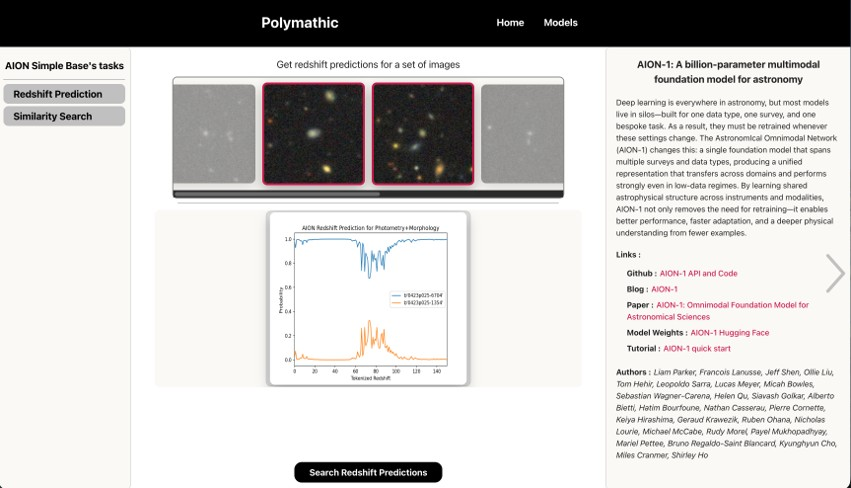
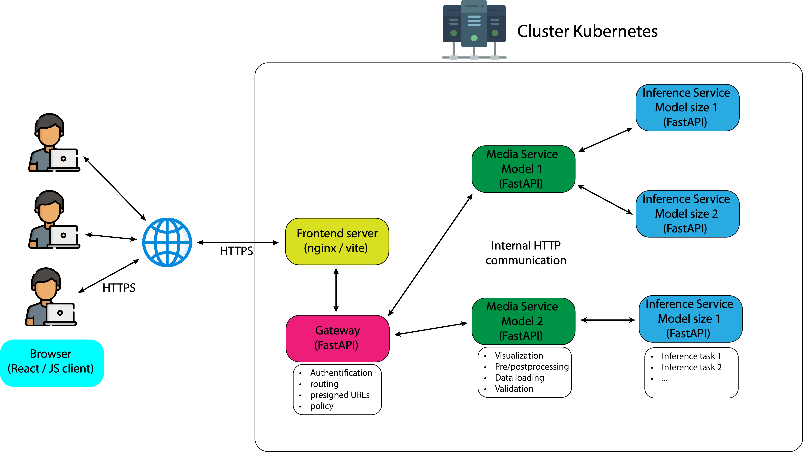

# SciMLDemo

## What is SciMLDemo?

**SciMLDemo** is a platform for deploying and testing scientific machine learning models through a shared API and an interactive web interface. Researchers can add their models by defining their data and inference workflows. Other researchers can then explore data, run inference, and visualize results directly in their browser.

## Who is it for?

Developed for the **Flatiron Institute**, SciMLDemo helps **Polymathic AI** researchers share models with the wider research community, across astronomy, biology, and other scientific fields.

## Version

This repository contains **beta 0.5**. The full version used in the deployed platform is maintained in the organization's GitHub repository and is not included here.

## Architecture and technologies

The platform uses separate services for the web interface, request routing, data processing, and model inference.

| Technology | Role |
| --- | --- |
| FastAPI | APIs and HTTP communication between services and nodes. |
| React | Interactive web interface. |
| PyTorch | Model loading and inference. |
| OpenCV | Image processing. |
| Docker | Building container images for the services. |
| Kubernetes | Orchestrating the containers. |
| Helm | Generating Kubernetes deployments from each model's configuration when a researcher adds a model. |
| Bash | Setup and deployment scripts. |

## Setup

The deployed platform runs on a node equipped with **8 NVIDIA Blackwell GPUs**.

The [setup script](scripts/setup.sh) builds service images, prepares storage, and deploys the platform with Helm. It targets the institute's environment and requires its paths, environment modules, and Kubernetes configuration to be adapted before use elsewhere.

## Supported features

See [Supported Features](docs/supported_features.md) for the supported dataset and media formats.

## Tutorials

These tutorials describe the version in this repository. The full deployed version is maintained separately in the organization's GitHub repository.

- [Getting started: add a model](docs/tutorials/add_a_model_quick_start/tutorial.md)
- [Advanced usage: add a model](docs/tutorials/add_a_model_advanced_usages/tutorial.md) (outline)
